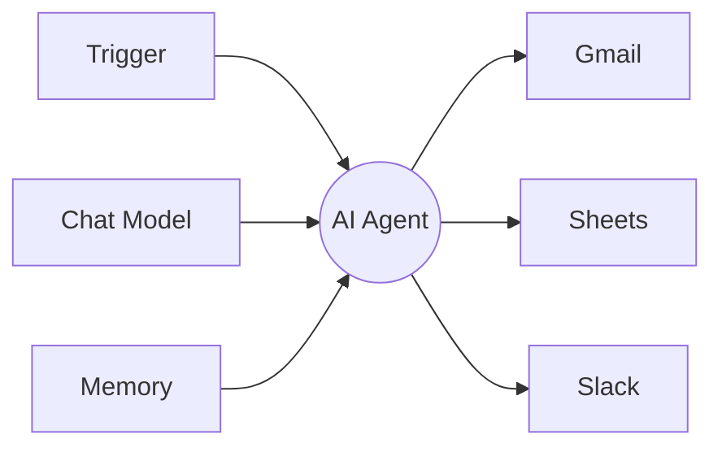
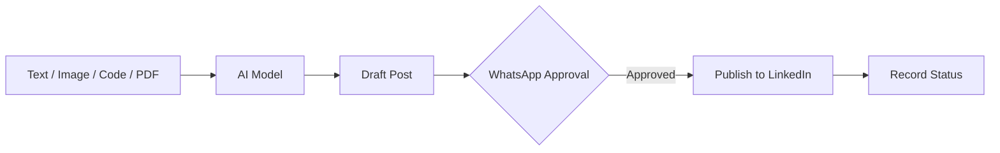

<div align="center">


# Hi, I'm Gandhyadapu Srinith 👋

### Aspiring AI/ML Engineer

*Learning Artificial Intelligence, building practical projects, and growing one step at a time.*

[](https://www.linkedin.com/in/srinith-g-19346438b/)
[](mailto:srinithcm@gmail.com)
[](https://github.com/Srinith222)


</div>

---

## 📌 Table of Contents

- [About Me](#-about-me)
- [Education](#-education)
- [Projects](#-projects)
- [Skills](#-skills)
- [Areas of Interest](#-areas-of-interest)
- [Certifications and Courses](#-certifications-and-courses)
- [Hackathons and Events](#-hackathons-and-events)
- [Student Activities and Roles](#-student-activities-and-roles)
- [Career Objective and Goals](#-career-objective-and-goals)
- [GitHub Stats](#-github-stats)
- [Get in Touch](#-get-in-touch)

---

## 👨‍💻 About Me

I am a second-year **B.Tech student in Computer Science and Engineering with Artificial Intelligence and Machine Learning (CSE-AIML)** at **St. Mary's Engineering College**.

I am passionate about **Artificial Intelligence, Machine Learning, Generative AI, AI agents and workflow automation**. I am continuously developing my programming skills and exploring practical ways to use AI to solve real-world problems.

I have explored AI workflow automation using **n8n** and taken part in a hands-on **linear regression workshop**. I enjoy learning new technologies, experimenting with tools, and building projects that strengthen my technical knowledge. Alongside these, I am working on:

- 🖼️ an **AI image detector** that tells real photos from AI-generated ones
- 🗄️ an **events and workshop registration system** built around DBMS concepts
- 🛒 a full-stack shopping web app called **ShopEasy**

**🎯 Current focus:** improving my Python programming, building a strong foundation in machine learning, developing practical AI projects, and gaining industry experience through internships.

---

## 🎓 Education

| | |
|---|---|
| **College** | St. Mary's Engineering College |
| **Degree** | Bachelor of Technology (B.Tech) |
| **Branch** | CSE, Artificial Intelligence and Machine Learning (CSE-AIML) |
| **Current Year** | Second Year |
| **Location** | India |

---

## 🚀 Projects

| # | Project | Type | Status |
|---|---------|------|--------|
| 01 | [AI Agent using n8n](#01--ai-agent-using-n8n) | AI and workflow automation | Built |
| 02 | [Linear Regression](#02--linear-regression) | Machine learning | Workshop |
| 03 | [Multimodal AI Content Assistant](#03--multimodal-ai-content-assistant) | Generative AI and automation | Planned |
| 04 | [AI Image Detector](#04--ai-image-detector) | Computer vision and deep learning | Project |
| 05 | [Events and Workshop Registration System](#05--events-and-workshop-registration-system) | DBMS and SQL | Project |
| 06 | [ShopEasy Shopping Web App](#06--shopeasy-shopping-web-app) | Full-stack web development | Project |

---

### 01 · AI Agent using n8n


**Overview.** Explored the development of an AI agent using n8n, a visual workflow automation platform. The project connects workflow components to automate tasks and explores how AI services can be incorporated into practical applications.



<details>
<summary><b>⚙️ How it works</b></summary>

<br>

n8n builds AI agents around one **AI Agent** node. A trigger starts the run, then the agent works with a chat model and can use memory and tools along the way.

| Component | Role |
|-----------|------|
| **Trigger** | Starts the workflow, for example a chat message or a webhook. |
| **Chat model** | The language model that reads the request and reasons about it. It is the one required part. |
| **Memory** | Optional. Simple Memory keeps recent messages of a conversation; Postgres or Redis memory keeps history outside n8n. |
| **Tools** | Optional but central. Any n8n node or sub-workflow can become a tool, such as Gmail, Slack or Google Sheets. |
| **Agent loop** | The agent thinks, calls a tool, reads the result and thinks again until it has an answer. |
| **System prompt** | Instructions that set the role and rules of the agent. |

> General background on n8n AI agents. The overview above describes my own project.

</details>

<details>
<summary><b>📚 What I learned</b></summary>

<br>

- Visual workflow design
- Automation logic
- How AI services connect to workflows
- How automated tasks are organised into a workflow

</details>

<details>
<summary><b>🔭 Next steps</b></summary>

<br>

- [ ] Add error handling and validation
- [ ] Integrate additional tools and APIs
- [ ] Add a clear user interface
- [ ] Document the workflow with screenshots
- [ ] Publish a demonstration and the source code

</details>

🔗 [GitHub](https://github.com/Srinith222)

---

### 02 · Linear Regression


**Overview.** Practical learning on linear regression, a supervised machine-learning technique that studies the relationship between variables and predicts numerical values. The workshop gave me exposure to the machine-learning workflow and the related Python tools.

<details>
<summary><b>⚙️ How it works</b></summary>

<br>

The model learns the straight line (`y = mx + b`) that best fits the data, then uses it to predict new values. A typical workflow:

1. **Collect data:** input features and a numeric target to predict
2. **Split** it into training and test sets, commonly 80% and 20%
3. **Fit** the model, which finds the line that minimises the mean squared error
4. **Predict** on the test data the model has not seen
5. **Evaluate** the predictions with MSE, RMSE and R²

| Metric | Meaning |
|--------|---------|
| **MSE** | The average of the squared gaps between actual and predicted values. |
| **RMSE** | The square root of MSE. It is in the same unit as the target, so it is easier to read. |
| **R²** | The share of the variation the model explains. 1 is perfect, and a low value does not always mean a bad model. |
| **Train vs test** | Similar errors on both suggest the model generalises. Much worse on test data points to overfitting. |

> General background on linear regression with scikit-learn.

</details>

<details>
<summary><b>📚 What I learned</b></summary>

<br>

- The basic idea of supervised learning
- How linear regression models are used for prediction
- The machine-learning development process
- Why data preparation and model evaluation matter

</details>

<details>
<summary><b>🔭 Next steps</b></summary>

<br>

- [ ] Build an independent regression model
- [ ] Use a suitable real-world dataset
- [ ] Evaluate predictions with appropriate metrics
- [ ] Publish a Jupyter notebook on GitHub

</details>

🔗 [GitHub](https://github.com/Srinith222)

---

### 03 · Multimodal AI Content Assistant


**Overview.** A proposed AI assistant that processes different types of input, such as text, images, code and PDF documents, and helps create technology content and programming-learning posts. A human approval step on WhatsApp comes before anything is published to LinkedIn.



> ⚠️ This is a planned concept and has not been built yet.

<details>
<summary><b>✅ How the approval step can work</b></summary>

<br>

n8n's WhatsApp Business Cloud node has a **"Send and Wait for Response"** operation. It sends a message and pauses the workflow until a person replies, so nothing gets published without a yes.

- **Approval buttons:** the reader can approve or disapprove straight from the message.
- **Free-text reply:** a person can answer with edits or extra information instead of a button.
- **Human review for agents:** the same pattern can pause an AI agent before it runs a tool that needs oversight.

> General background on n8n. My own design is described in the overview above.

</details>

<details>
<summary><b>🧩 Planned features</b></summary>

<br>

- [ ] Process different input formats
- [ ] Generate draft content
- [ ] Organise content into a workflow
- [ ] Request approval before publishing
- [ ] Maintain a record of workflow status

</details>

---

### 04 · AI Image Detector


**Overview.** An AI image detector that checks whether a picture is a real photograph or was created by AI. You give it an image and it returns a verdict: **real** or **AI-generated**. It is a response to how realistic AI-made images have become, and to the need to tell them apart.

<details>
<summary><b>⚙️ How it works</b></summary>

<br>

Detection is treated as a **binary classification** problem: a model is trained on labelled real and AI-generated images, then predicts which class a new image belongs to.

1. Collect a dataset of real photos and AI-generated images
2. Pre-process them: resize, normalise and augment
3. Train a classifier to learn the difference between the two classes
4. Predict on a new image and output real or AI-generated
5. Evaluate with accuracy and on images from generators it has not seen

| Concept | Description |
|---------|-------------|
| **Spatial cues** | Colour, gradient, noise and texture patterns left behind by a generator. CNN-based detectors learn these directly from pixels. |
| **Frequency cues** | Generated images often show unusual high-frequency energy, because the upsampling steps inside generators leave traces. An FFT exposes them. |
| **Hybrid models** | Newer research combines frequency features with semantic features from vision transformers such as CLIP-ViT for better results. |
| **Probability score** | A classifier ends in a probability, for example 0.92 AI-generated, which is more honest than a hard yes or no. |

> General background from AI-generated image detection research, including [this survey](https://arxiv.org/abs/2502.19716).

</details>

<details>
<summary><b>⚠️ Challenges</b></summary>

<br>

- **Generalisation:** detectors often perform well on the generators they were trained on and drop sharply on new, unseen ones
- **Diffusion models:** their frequency artifacts are less obvious than those of older GANs, so methods that lean only on spectral traces can weaken
- **Image changes:** blur, resizing and JPEG compression can hide the traces a detector relies on
- **No certainty:** a result is a likelihood, not proof, so it should support human judgement rather than replace it

</details>

<details>
<summary><b>🔭 Next steps</b></summary>

<br>

- [ ] Show a confidence score with every verdict
- [ ] Test on images from several different AI generators
- [ ] Try adding frequency (FFT) features alongside the pixel model
- [ ] Highlight the image regions that influenced the decision
- [ ] Build a simple upload page and publish the code on GitHub

</details>

🔗 [GitHub](https://github.com/Srinith222)

---

### 05 · Events and Workshop Registration System


**Overview.** A database management system for events and workshops. Organisers add events and workshops, participants register for them, and the database keeps track of who signed up, who attended and how many seats remain. The project applies core DBMS ideas: **ER modelling, relational tables, keys, normalisation and SQL queries**.

<details>
<summary><b>⚙️ How it works</b></summary>

<br>

The design starts from the data and works toward the queries:

1. List the entities: participants, events, workshops, organisers
2. Draw the ER diagram and mark the relationships
3. Turn it into tables with primary and foreign keys
4. Normalise the tables to remove repeated data
5. Write SQL to register, cancel, count seats and list attendees

| Concept | Description |
|---------|-------------|
| **Many-to-many link** | A participant can join many events and an event has many participants, so a registration table sits between them. |
| **Constraints** | A `UNIQUE` key stops double registration. Foreign keys keep every registration tied to a real person and event. A capacity check stops overbooking. |
| **Transactions** | If two people grab the last seat at once, a transaction makes sure only one booking succeeds and the data stays correct. |
| **Queries and reports** | `JOIN`, `GROUP BY` and `COUNT` answer questions such as attendees per workshop or seats left in an event. |

Illustrative example:

```sql
CREATE TABLE registration (
    reg_id         INT PRIMARY KEY,
    participant_id INT REFERENCES participant(participant_id),
    event_id       INT REFERENCES event(event_id),
    reg_date       DATE,
    UNIQUE (participant_id, event_id)
);
```

</details>

<details>
<summary><b>🔭 Next steps</b></summary>

<br>

- [ ] Add a waitlist that fills seats automatically when someone cancels
- [ ] Generate a ticket or QR code for each registration and use it for check-in
- [ ] Collect feedback after each event and report on it
- [ ] Add indexes and test the queries on a larger set of data
- [ ] Add a simple front end and publish the schema and SQL on GitHub

</details>

🔗 [GitHub](https://github.com/Srinith222)

---

### 06 · ShopEasy Shopping Web App


**Overview.** ShopEasy is a full-stack shopping web application. Customers browse products, add them to a cart and place orders, while the backend and database look after accounts, products and orders. It covers the whole path of a web app, from the page in the browser to the data stored on the server.

<details>
<summary><b>⚙️ How it works</b></summary>

<br>

Most shopping apps use a **three-tier design**: a frontend the customer sees, a backend that holds the logic, and a database that stores the data. Here is how one action, *adding an item to the cart*, travels through them:

1. The customer clicks **Add to cart** on the frontend
2. The frontend sends a request to the backend API, with the login token attached
3. The backend checks who the user is and that the product exists
4. The database stores the new cart item
5. The backend replies and the frontend updates the cart on screen

| Layer | Description |
|-------|-------------|
| **Frontend** | The pages the customer uses: product list, product detail, cart, checkout and login. It talks to the backend over HTTP. |
| **Backend API** | Receives requests, applies the rules and reads or writes data. Each feature, such as products, cart and orders, gets its own endpoints. |
| **Database** | Stores users, products, carts and orders. A relational database links them with keys, a document database stores them as records. |
| **Authentication** | Users log in and receive a token, commonly a JWT, which the frontend sends with each request so private routes stay protected. |

Illustrative endpoints:

```http
POST /api/auth/login
GET  /api/products
POST /api/cart/items
POST /api/orders
```

</details>

<details>
<summary><b>🔭 Next steps</b></summary>

<br>

- [ ] Add product search, filters and pagination
- [ ] Add an admin page to manage products and orders
- [ ] Add online payment with a payment gateway
- [ ] Validate all input and limit repeated requests on the server
- [ ] Deploy the app online and publish the code on GitHub

</details>

🔗 [GitHub](https://github.com/Srinith222)

---

## 🛠️ Skills

| Category | Skills |
|----------|--------|
| **Programming** | Python (basic), HTML (basic), full-stack web development (project work) |
| **AI and ML** | Fundamentals of AI, ML fundamentals, linear regression (workshop exposure), AI agents (project exploration), generative AI (learning), image classification (project work) |
| **Databases** | DBMS fundamentals, ER modelling, SQL (learning, through the registration system project) |
| **Tools** | n8n for AI workflow automation, Google Colab for machine learning, GitHub for projects and code |
| **Professional** | Continuous learning, problem-solving, team collaboration, communication, adaptability, technical exploration |


> Skill levels show where I am today and will grow with practice.

---

## 💡 Areas of Interest

`Artificial Intelligence` · `Machine Learning` · `Generative AI` · `AI Agents` · `Workflow Automation` · `Python Programming` · `Computer Vision` · `Full-Stack Development` · `Databases and SQL` · `Data Science Fundamentals` · `Software Development` · `Real-World AI Applications`

---

## 📜 Certifications and Courses

| Certification | Issuer | Date |
|---------------|--------|------|
| **Google AI Professional Certificate** | Google on Coursera | Jun 28, 2026 |
| **AI Fundamentals** | Google on Coursera | Jun 26, 2026 |
| **AI for Brainstorming and Planning** | Google on Coursera | Jun 26, 2026 |
| **AI for Data Analysis** | Google on Coursera | Jun 28, 2026 |
| **Claude 101** | Anthropic | n/a |
| **AI Fluency: Framework & Foundations** | Anthropic | n/a |
| **No-code Machine Learning and Generative AI on AWS** | AWS Training & Certification | Aug 4, 2026 |
| **AI for Beginners** | HP LIFE, HP Foundation | 6 Aug 2026 |
| **Python (Basic)** | HackerRank | 14 Jul 2026 |
| **Exploratory Data Analysis (EDA)** | FutureSkills Prime / Nasscom | 15 Aug 2026 |

<details open>
<summary><b>🖼️ Certificate gallery (click an image to enlarge)</b></summary>

<br>

<table>
<tr>
<td align="center" width="50%"><a href="assets/certificates/google-ai-professional.jpg"></a><br/><sub><b>Google AI Professional Certificate · Google on Coursera</b></sub></td>
<td align="center" width="50%"><a href="assets/certificates/ai-fundamentals.jpg"></a><br/><sub><b>AI Fundamentals · Google on Coursera</b></sub></td>
</tr>
<tr>
<td align="center" width="50%"><a href="assets/certificates/ai-brainstorming-planning.jpg"></a><br/><sub><b>AI for Brainstorming and Planning · Google on Coursera</b></sub></td>
<td align="center" width="50%"><a href="assets/certificates/ai-data-analysis.jpg"></a><br/><sub><b>AI for Data Analysis · Google on Coursera</b></sub></td>
</tr>
<tr>
<td align="center" width="50%"><a href="assets/certificates/claude-101.jpg"></a><br/><sub><b>Claude 101 · Anthropic</b></sub></td>
<td align="center" width="50%"><a href="assets/certificates/ai-fluency.jpg"></a><br/><sub><b>AI Fluency: Framework & Foundations · Anthropic</b></sub></td>
</tr>
<tr>
<td align="center" width="50%"><a href="assets/certificates/aws-no-code-ml-genai.jpg"></a><br/><sub><b>No-code ML and Generative AI on AWS · AWS Training</b></sub></td>
<td align="center" width="50%"><a href="assets/certificates/hp-life-ai-beginners.jpg"></a><br/><sub><b>AI for Beginners · HP LIFE</b></sub></td>
</tr>
<tr>
<td align="center" width="50%"><a href="assets/certificates/hackerrank-python-basic.jpg"></a><br/><sub><b>Python (Basic) · HackerRank</b></sub></td>
<td align="center" width="50%"><a href="assets/certificates/eda-futureskills-prime.jpg"></a><br/><sub><b>Exploratory Data Analysis · FutureSkills Prime / Nasscom</b></sub></td>
</tr>
</table>

</details>

---

## 🏆 Hackathons and Events

| Event | Type | Date | Details |
|-------|------|------|---------|
| **HackWithHyderabad 3.0** | Hackathon | 3 Oct 2026 | 8-hour technology hackathon at the Microsoft Office, Hyderabad. Certificate of participation from Hack With India × Devnovate. |
| **Adobe University Hackathon 2026** | Hackathon | 9 Aug 2026 | Participated in the hackathon organised by Adobe, through Unstop. |
| **Elite Coders Open Source Hackathon** | Hackathon | 2026 | Certificate of Appreciation for qualifying the Pre-Assessment Round of the Open Source Hackathon 2026. |
| **Nexus AI Quiz Ignite 2026** | Quiz | 2026 | Certificate of participation. |
| **Qrisis** | Competition | n/a | Certificate of achievement for completing a mathematics and logical reasoning competition. |
| **AINCAT 2026** | Aptitude test | 1 Jun 2026 | Participated in India's biggest career aptitude test, conducted by Naukri Campus. |
| **Google Developer Get Certified** | Cohort | 9 Sep 2026 | Earned the Get Certified application badge from the Google Developer Program, a no-cost guided cohort for preparing for a Google Cloud certification exam. |
| **Generative AI Workshop** | Workshop, IIT Hyderabad | 31 Jan to 1 Feb 2026 | Certificate of participation. Organised by Elan & nVision, IIT Hyderabad, in association with IncuXai. |
| **Work Smarter with AI** | Workshop | 30 May 2026 | Exploring AI tools and practical techniques to boost productivity, organised by Horizon Community. |

<details open>
<summary><b>🖼️ Event gallery (click an image to enlarge)</b></summary>

<br>

<table>
<tr>
<td align="center" width="50%"><a href="assets/events/hackwithhyderabad-3.jpg"></a><br/><sub><b>HackWithHyderabad 3.0</b></sub></td>
<td align="center" width="50%"><a href="assets/events/adobe-university-hackathon.jpg"></a><br/><sub><b>Adobe University Hackathon 2026</b></sub></td>
</tr>
<tr>
<td align="center" width="50%"><a href="assets/events/elite-coders-open-source.jpg"></a><br/><sub><b>Elite Coders Open Source Hackathon</b></sub></td>
<td align="center" width="50%"><a href="assets/events/nexus-ai-quiz-ignite.jpg"></a><br/><sub><b>Nexus AI Quiz Ignite 2026</b></sub></td>
</tr>
<tr>
<td align="center" width="50%"><a href="assets/events/qrisis.jpg"></a><br/><sub><b>Qrisis Competition</b></sub></td>
<td align="center" width="50%"><a href="assets/events/aincat-2026.jpg"></a><br/><sub><b>AINCAT 2026</b></sub></td>
</tr>
<tr>
<td align="center" width="50%"><a href="assets/events/google-developer-get-certified.jpg"></a><br/><sub><b>Google Developer Get Certified Badge</b></sub></td>
<td align="center" width="50%"><a href="assets/events/generative-ai-workshop-iith.jpg"></a><br/><sub><b>Generative AI Workshop · IIT Hyderabad</b></sub></td>
</tr>
<tr>
<td align="center" width="50%"><a href="assets/events/work-smarter-with-ai.jpg"></a><br/><sub><b>Work Smarter with AI Workshop</b></sub></td>
<td></td>
</tr>
</table>

<br>

**Generative AI Workshop at IIT Hyderabad (31 Jan to 1 Feb 2026)**

<table>
<tr>
<td align="center" width="50%"><br/><sub><b>At the IIT Hyderabad venue</b></sub></td>
<td align="center" width="50%"><br/><sub><b>Workshop slide: how an LLM turns a prompt into an answer</b></sub></td>
</tr>
</table>

</details>

---

## 🤝 Student Activities and Roles

| Role | Organisation | Since | Focus |
|------|--------------|-------|-------|
| **College Ambassador** | Techfest, IIT Bombay (Techfest 2026-27) | 1 Jul 2026 | Student outreach and technology-community engagement |
| **Student Partner** | Internshala | 26 Sep 2026 | Student engagement and sharing learning and career opportunities |
| **Campus Ambassador** | Acmegrade | 7 Sep 2026 | Campus outreach and student-community engagement |

---

## 🎯 Career Objective and Goals

**Career objective.** To get an AI/ML internship where I can apply my foundational programming knowledge, build practical skills in Artificial Intelligence and Machine Learning, work on real-world projects, learn from experienced professionals, and contribute to innovative technology solutions.

**Career goal.** To become a skilled AI/ML professional by building a strong foundation in programming, mathematics, machine learning and practical AI development.

I am looking for **beginner-friendly AI/ML internship opportunities** where I can learn from experienced developers, contribute to projects, collaborate with teams, and gain real-world technical experience.

---

## 📊 GitHub Stats

<div align="center">


</div>

My GitHub holds Python practice, machine-learning notebooks and AI agent workflow notes.

---

## 📫 Get in Touch

Open to **AI/ML internships, technical learning opportunities, project collaboration, and beginner-friendly development opportunities.** Email is the fastest way to reach me.

| | |
|---|---|
| 📧 **Email** | [srinithcm@gmail.com](mailto:srinithcm@gmail.com) |
| 💼 **LinkedIn** | [linkedin.com/in/srinith-g-19346438b](https://www.linkedin.com/in/srinith-g-19346438b/) |
| 🐙 **GitHub** | [github.com/Srinith222](https://github.com/Srinith222) |
| 📍 **Location** | India |

Have a question, a project idea, or want to collaborate? Reach out and I will reply as soon as I can.

<div align="center">

⭐ *Learning Artificial Intelligence, building practical projects, and growing one step at a time.* ⭐

</div>

<!--
**Srinith222/Srinith222** is a ✨ _special_ ✨ repository because its `README.md` (this file) appears on your GitHub profile.

Here are some ideas to get you started:

- 🔭 I’m currently working on ...
- 🌱 I’m currently learning ...
- 👯 I’m looking to collaborate on ...
- 🤔 I’m looking for help with ...
- 💬 Ask me about ...
- 📫 How to reach me: ...
- 😄 Pronouns: ...
- ⚡ Fun fact: ...
-->
